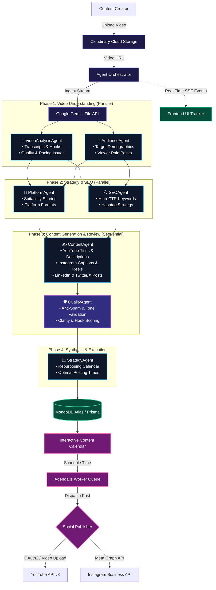

# 🚀 ReachAI — Agentic AI Social Media Planner & Companion

> Transform a single video into a high-converting, multi-platform content engine powered by a coordinated 7-agent AI pipeline, automated scheduling, and direct social publishing.

[](https://nodejs.org/)
[](https://react.dev/)
[](https://vitejs.dev/)
[](https://ai.google.dev/)
[](https://www.mongodb.com/atlas)
[](https://www.prisma.io/)
[](https://cloudinary.com/)
[](https://upstash.com/)
[](https://firebase.google.com/)

---

## 📖 Overview

**ReachAI** is an intelligent, full-stack social media companion built for modern content creators, brands, and digital agencies. Uploading raw video content triggers an autonomous **7-Agent AI Orchestrator** driven by Google Gemini's Multimodal File API. 

The system analyzes speech, visuals, hooks, and pacing, generates platform-native copy (YouTube, Instagram, LinkedIn, Twitter/X), audits quality, schedules posts on an interactive calendar, and publishes directly to social channels via background workers.

---

## ✨ Key Features

- **Multimodal Video Understanding**: Ingests raw videos via Cloudinary and Google Gemini File API to understand visual scenes, pacing, speech, and hook effectiveness.
- **7-Agent Orchestrated Pipeline**: Modular AI agents collaborate in parallel and sequential phases to analyze, strategize, generate, audit, and synthesize content.
- **Real-Time Progress Streaming (SSE)**: Server-Sent Events (SSE) keep the user visually updated on every step of the AI agent analysis in real time.
- **Cross-Platform Content Studio**: Instant generation and interactive editing for:
  - **YouTube**: SEO titles, search-optimized descriptions, tags, and thumbnail concepts.
  - **Instagram**: Engaging captions, Reels scripts, carousel slides, and targeted hashtags.
  - **LinkedIn & Twitter/X**: Professional hooks, long-form insights, and punchy threads.
- **Visual Content Calendar & Scheduler**: Interactive drag-and-drop planning calendar powered by **Agenda.js** and MongoDB with atomic locking to prevent duplicate runs.
- **Automated Social Publishing**:
  - **YouTube Data API v3**: Direct automated upload and metadata sync.
  - **Meta Graph API (Instagram)**: Automated Reels and carousel publishing.
- **Live Analytics Dashboard**: Real-time performance tracking (views, watch time, CTR, likes) directly fetched from social platform APIs.
- **Enterprise-Grade Security**: AES-256 token encryption at rest for user OAuth credentials, distributed rate-limiting via Redis, and secure Firebase JWT authentication.

---

## 🤖 The 7-Agent Architecture & Workflow

The core of ReachAI is its hierarchical agent pipeline managed by the [`AgentOrchestrator`](file:///c:/Roshith/Projects/Social-Media-Planner/Backend/src/agents/AgentOrchestrator.js). Rather than using a single generic prompt, the workflow partitions complex reasoning into specialized agents across 4 distinct phases:



### Breakdown of AI Agents

| Agent | Phase | Role & Capabilities |
| :--- | :---: | :--- |
| **`VideoAnalysisAgent`** | 1 | Watches the video via Gemini File API; extracts complete transcripts, identifies hook retention quality, identifies video pacing/audio issues. |
| **`AudienceAgent`** | 1 | Profiles primary and secondary target demographics, audience intent, core pain points, and psychological hooks. |
| **`PlatformAgent`** | 2 | Evaluates performance potential across YouTube, Instagram, LinkedIn, and Twitter/X with platform-specific ratings. |
| **`SEOAgent`** | 2 | Generates high-CTR keywords, algorithmic tags, search intent mappings, and platform hashtag clusters. |
| **`ContentAgent`** | 3 | Drafts ready-to-publish assets: YouTube metadata, Instagram Reels scripts & carousels, LinkedIn articles, and Twitter threads. |
| **`QualityAgent`** | 3b | Acts as an editor-in-chief: scores hook strength, detects generic or hallucinated statements, ensures brand safety, and applies polish. |
| **`StrategyAgent`** | 4 | Synthesizes all intelligence into a multi-day distribution roadmap, cross-platform repurposing plan, and optimal posting windows. |

---

## 🛠️ Technology Stack

### Frontend
- **Framework**: [React 18](https://react.dev/) with [Vite](https://vitejs.dev/)
- **Routing**: [React Router v6](https://reactrouter.com/)
- **Styling**: Vanilla CSS design system with custom CSS variables, dark theme aesthetics, and glassmorphism
- **Animations**: [Framer Motion](https://www.framer.com/motion/)
- **State & Real-time**: React Context API, Server-Sent Events (`EventSource`)
- **Authentication**: [Firebase Authentication](https://firebase.google.com/) Client SDK

### Backend
- **Runtime**: [Node.js](https://nodejs.org/) (ES Modules)
- **Server Framework**: [Express 5](https://expressjs.com/) with [Helmet](https://helmetjs.github.io/) & CORS
- **Database & ORM**: [MongoDB Atlas](https://www.mongodb.com/atlas) with [Prisma ORM](https://www.prisma.io/)
- **AI Engine**: [Google Gemini 2.5 Flash / Gemini 3 Preview](https://aistudio.google.com/) (`@google/genai`)
- **Job Scheduler**: [Agenda.js](https://github.com/agenda/agenda) with MongoDB backing and atomic locks
- **Caching & Rate Limiting**: [Redis](https://redis.io/) (Upstash / Redis Cloud) with `express-rate-limit`
- **Cloud Media**: [Cloudinary](https://cloudinary.com/) (Direct unsigned/signed uploads, video streaming)
- **Security**: AES-256 cipher encryption for social OAuth tokens at rest

---

## 📁 Repository Structure

```text
Social-Media-Planner/
├── Backend/
│   ├── index.js                     # Express entry point, middleware, routes, scheduler init
│   ├── Dockerfile                   # Production Docker container definition
│   ├── prisma/
│   │   └── schema.prisma            # Prisma schema (User, Project, VideoAnalysis, ScheduledPost)
│   └── src/
│       ├── agents/                  # 7-Agent autonomous pipeline
│       │   ├── AgentOrchestrator.js # Parallel/Sequential orchestration engine
│       │   ├── BaseAgent.js         # Base abstract agent with Gemini calls
│       │   ├── VideoAnalysisAgent.js# Multimodal visual analysis
│       │   ├── AudienceAgent.js     # Target audience profiling
│       │   ├── PlatformAgent.js     # Platform compatibility scoring
│       │   ├── SEOAgent.js          # Keywords, tags, and hashtag strategies
│       │   ├── ContentAgent.js      # Copywriting generator
│       │   ├── QualityAgent.js      # Audit, compliance, and polish
│       │   └── StrategyAgent.js     # Multi-platform posting strategy
│       ├── config/                  # Database, Gemini, Redis, Cloudinary & Agenda configurations
│       ├── controllers/             # Express controllers (auth, videos, analysis, schedule, etc.)
│       ├── jobs/                    # Agenda background job workers (publishPost.job.js)
│       ├── middleware/              # Authentication, rate limiting, and Zod validation
│       ├── routes/                  # RESTful API route definitions
│       ├── services/                # YouTube, Instagram, Analytics, and Social services
│       └── utils/                   # AES-256 crypto, SSE emitter, and Google client
└── Frontend/
    ├── index.html                   # HTML entry
    ├── vite.config.js               # Vite build configuration
    └── src/
        ├── App.jsx                  # Main application routes and layout wrappers
        ├── api/                     # Axios/Fetch API client functions
        ├── components/              # UI components (AgentProgressTracker, RouteGuards, etc.)
        ├── context/                 # AuthContext and UserContext
        ├── pages/
        │   ├── Landing.jsx          # Public showcase and features
        │   ├── Login.jsx / Signup   # Auth flows
        │   ├── Onboarding.jsx       # User niche and brand tone setup
        │   └── app/                 # Authenticated application suite
        │       ├── UploadPage.jsx   # Video drag & drop with Cloudinary
        │       ├── AnalysisPage.jsx # Multi-agent results & content studio
        │       ├── CalendarPage.jsx # Drag-and-drop posting schedule
        │       ├── AnalyticsPage.jsx# Live social metric visualization
        │       ├── ProjectsPage.jsx # Past video projects archive
        │       └── ProfilePage.jsx  # Connected accounts & settings
        └── index.css                # Global styles, variables, and typography
```

---

## ⚙️ Environment Configuration

### Backend (`Backend/.env`)

Create a `.env` file in the `Backend` directory:

```env
# Server
PORT=4000
NODE_ENV=development
FRONTEND_URL=http://localhost:3000

# MongoDB Atlas
DATABASE_URL="mongodb+srv://<username>:<password>@cluster0.mongodb.net/ReachAI?retryWrites=true&w=majority"

# Security (AES-256 32-byte hex key for OAuth token encryption at rest)
ENCRYPTION_KEY="your-32-byte-hex-encryption-key"

# Redis (Upstash / Redis Cloud / Local)
REDIS_URL="rediss://default:<password>@<host>:<port>"

# Google Gemini API
GEMINI_KEY="your-gemini-api-key"
GEMINI_MODEL="gemini-2.5-flash"

# Cloudinary
CLOUDINARY_CLOUD="your-cloud-name"
CLOUDINARY_APIKEY="your-api-key"
CLOUDINARY_APISECRET="your-api-secret"

# Firebase Authentication
FIREBASE_WEB_API_KEY="your-firebase-web-api-key"
SKIP_AUTH=false

# YouTube Data API v3 (Google Cloud Console OAuth 2.0 Credentials)
GOOGLE_CLIENT_ID="your-google-client-id"
GOOGLE_CLIENT_SECRET="your-google-client-secret"
GOOGLE_REDIRECT_URI="http://localhost:4000/api/v1/youtube/callback"

# Meta Graph API (Instagram Business OAuth)
META_APP_ID="your-meta-app-id"
META_APP_SECRET="your-meta-app-secret"
INSTAGRAM_REDIRECT_URI="http://localhost:4000/api/v1/instagram/callback"
```

### Frontend (`Frontend/.env`)

Create a `.env` file in the `Frontend` directory:

```env
# Backend API URLs
VITE_API_URL=http://localhost:4000
VITE_API_BASE_URL=http://localhost:4000/api/v1

# Cloudinary
VITE_CLOUDINARY_CLOUD_NAME=your-cloud-name

# Firebase Client Config
VITE_FIREBASE_API_KEY=your-firebase-api-key
VITE_FIREBASE_AUTH_DOMAIN=your-app.firebaseapp.com
VITE_FIREBASE_PROJECT_ID=your-project-id
VITE_FIREBASE_STORAGE_BUCKET=your-app.firebasestorage.app
VITE_FIREBASE_MESSAGING_SENDER_ID=your-sender-id
VITE_FIREBASE_APP_ID=your-app-id
```

---

## 🚀 Getting Started

### 1. Prerequisites

- [Node.js](https://nodejs.org/) (v18 or higher recommended)
- [MongoDB Atlas](https://www.mongodb.com/atlas) cluster (or local MongoDB)
- [Redis](https://upstash.com/) instance (optional; fallback to in-memory/MongoDB supported)
- [Google AI Studio](https://aistudio.google.com/) Gemini API Key

---

### 2. Backend Setup

```bash
# Navigate to the Backend folder
cd Backend

# Install dependencies
npm install

# Push the Prisma schema to MongoDB
npx prisma db push

# Generate the Prisma Client
npx prisma generate

# Start the development server
npm run dev
```

The backend server will run on `http://localhost:4000`.

---

### 3. Frontend Setup

```bash
# Open a new terminal and navigate to Frontend
cd Frontend

# Install dependencies
npm install

# Start the Vite development server
npm run dev
```

The frontend application will run on `http://localhost:5173` (or `http://localhost:3000`).

---

### 4. Running with Docker (Backend)

A production-ready `Dockerfile` is provided for the backend service:

```bash
cd Backend
docker build -t reachai-backend .
docker run -p 4000:4000 --env-file .env reachai-backend
```

---

## 📡 API Reference Overview

| Module | Route | Method | Description |
| :--- | :--- | :---: | :--- |
| **Health** | `/api/v1` | `GET` | API health check and version status |
| **Auth** | `/api/v1/auth/sync` | `POST` | Synchronize Firebase authenticated user with MongoDB |
| **Videos** | `/api/v1/videos/upload` | `POST` | Create video project and register Cloudinary media |
| **Videos** | `/api/v1/videos/projects` | `GET` | List all user video projects |
| **Analysis** | `/api/v1/analysis/start/:projectId` | `POST` | Trigger the 7-agent AI orchestration pipeline |
| **Analysis** | `/api/v1/analysis/stream/:projectId` | `GET` | SSE stream for real-time agent execution events |
| **Analysis** | `/api/v1/analysis/:projectId` | `GET` | Retrieve complete agent analysis results |
| **Drafts** | `/api/v1/drafts` | `GET/POST` | Manage and save customized platform drafts |
| **Schedule** | `/api/v1/schedule` | `GET/POST` | Retrieve and create scheduled posts for the calendar |
| **Schedule** | `/api/v1/schedule/:id` | `DELETE` | Cancel a pending scheduled post |
| **YouTube** | `/api/v1/youtube/auth-url` | `GET` | Generate YouTube OAuth2 consent URL |
| **YouTube** | `/api/v1/youtube/callback` | `GET` | OAuth callback to exchange and store tokens |
| **Instagram** | `/api/v1/instagram/auth-url` | `GET` | Generate Meta Graph API OAuth consent URL |
| **Instagram** | `/api/v1/instagram/callback` | `GET` | Meta OAuth callback and long-lived token exchange |
| **Analytics** | `/api/v1/analytics/:projectId` | `GET` | Live analytics summary and chart timeseries |

---

## 🔒 Security Best Practices Implemented

- **Token Encryption**: Third-party OAuth tokens (YouTube refresh tokens, Instagram long-lived tokens) are encrypted using AES-256-CBC with per-user IVs prior to persisting to MongoDB Atlas.
- **Distributed Rate Limiting**: Sensitive routes are protected with Redis-backed token bucket rate limiters to prevent DDoS and LLM quota exhaustion.
- **Strict Data Validation**: Request payloads are strongly typed and validated using [Zod](https://zod.dev/) schemas.
- **HTTP Hardening**: Configured with [Helmet](https://helmetjs.github.io/) to enforce CSP, frameguard, and hide runtime identifiers (`x-powered-by`).

---

## 📄 License

This project is licensed under the **ISC License**.
